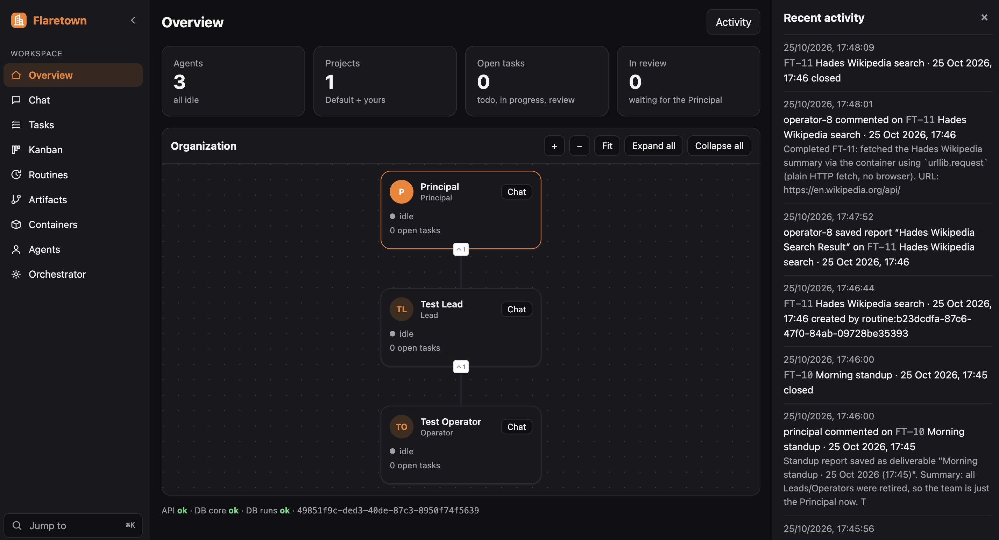

# Flaretown

**Agent orchestration on Cloudflare.**

Run a small company of AI agents on your own Cloudflare account. A Principal plans the work, Leads split it, Operators get it done, and you review the results. Spin up as many Leads and Operators as the work needs, and retire them when it's done. No servers, no Kubernetes, no API keys to babysit: everything runs on Workers, Durable Objects and Workers AI, fully under your control.

[](https://deploy.workers.cloudflare.com/?url=https://github.com/cortezcristian/flaretown)



*Two-minute demo: an Operator opens a browser in its own container and you watch it live next to the chat.*

https://github.com/user-attachments/assets/915613da-56fa-4be6-b1a4-0a8990c9b474

## What you get

- **An org chart that works.** Principal › Leads › Operators. Agents create tasks with acceptance criteria, delegate, review each other and only close work that meets the bar.
- **Tasks, Kanban and Routines.** Give work to any agent, watch it move across the board, or schedule it ("every weekday at 8am").
- **Code Mode.** Agents write JavaScript that runs in a sandboxed Dynamic Worker and calls their own tools.
- **A computer per agent.** Optional Linux container: a Debian shell, or a desktop with Chromium you can watch and drive live (noVNC) right next to the chat. The browser login survives restarts.
- **Git for every agent.** Each agent writes its reports and files to its own Cloudflare Artifacts repo, with history and retention.
- **Private by default.** The whole app sits behind Cloudflare Access: only the emails you allow get in.

## Install

You need a Cloudflare account on **Workers Paid** ($5/month). Cloudflare Zero Trust (free plan) gives you Access.

### 1. Lock the door first

Create the Access policy and application **before** you deploy, so the app is never public, not even for a minute.

1. **Zero Trust → Access controls → Policies → Add a policy**
   - Name: `flaretown`
   - Action: **Allow**
   - Include → **Emails** → your email (add teammates here later)
2. **Zero Trust → Access controls → Applications → Add an application → Self-hosted**
   - Domain: `<worker-name>.<your-subdomain>.workers.dev` (for example `flaretown.acme.workers.dev`)
   - Policies: `flaretown`
   - Session duration: 1 week

### 2. Deploy

Click **Deploy to Cloudflare** above. On the setup page:

- **Worker name** must match the domain from step 1. Trying it next to an existing install? Use something like `flaretown-v1` and give the databases and bucket new names too.
- Cloudflare forks the repo into your GitHub, creates the D1 databases, the R2 bucket and the Durable Objects, builds and deploys. The deploy step also runs the database migrations.

### 3. Open it

Go to `https://<worker-name>.<your-subdomain>.workers.dev`. Cloudflare asks for your email and sends you a one-time code. Allowed emails get in; nobody else does.

Start in **Chat** with the Principal, or create a task in **Tasks**.

## What it costs

Workers Paid covers most of it. The parts that can grow are opt-in:

| Feature | Billed as | Default |
|---|---|---|
| Agents (chat, tasks) | Workers AI tokens | On |
| Code Mode | Dynamic Workers | On (Settings) |
| Agent containers | Containers, per 10 ms running | **Off** (Settings) |
| Agent repos | Cloudflare Artifacts | Created per agent |

Containers stop after 10 minutes idle, and you can cap how many run per tier in **Settings**.

## Deploy by hand

```bash
pnpm install
pnpm wrangler login
pnpm run deploy        # deploys and applies the D1 migrations
```

Needs Node.js 22.18+, pnpm, and Docker running (the desktop container image is built at deploy). Protect the Worker with Access first (step 1).

No Docker, or only Worker code changed? `pnpm run deploy:no-containers` deploys the Worker and leaves container images and running containers as they are.

## Remove everything

```bash
pnpm teardown
```

Deletes the Worker, both databases and the bucket, and lists what to delete by hand (agent repos, container images).

## License

MIT
